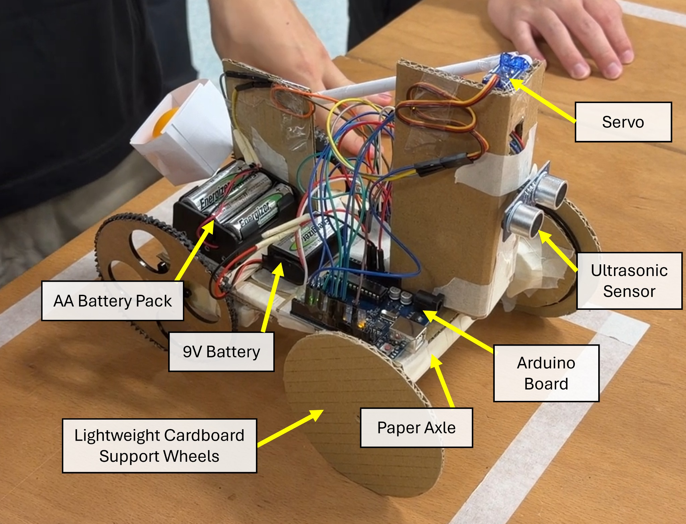
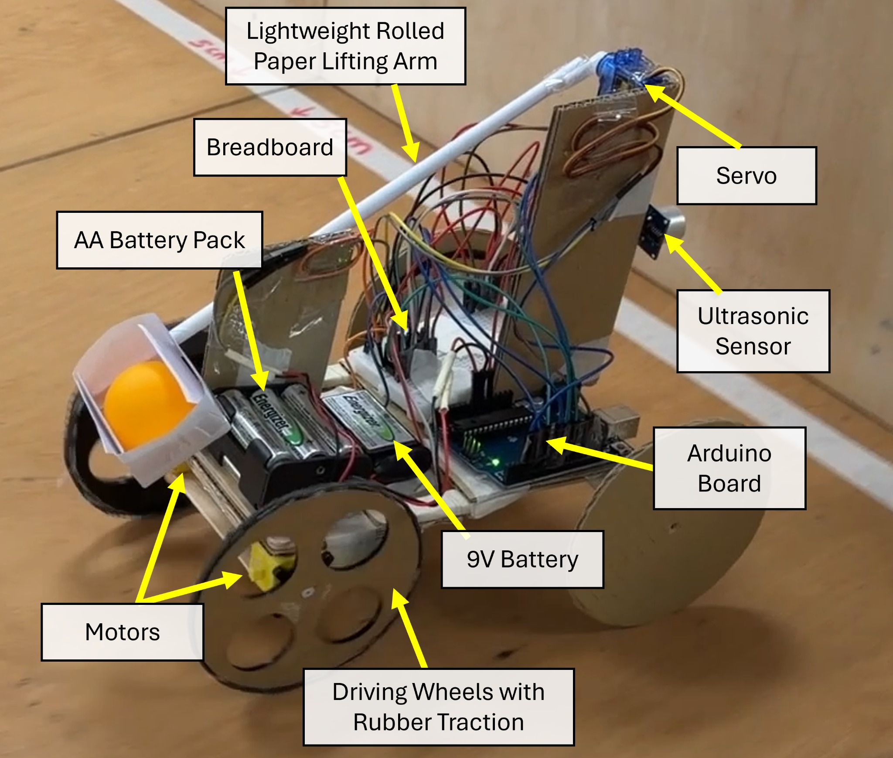
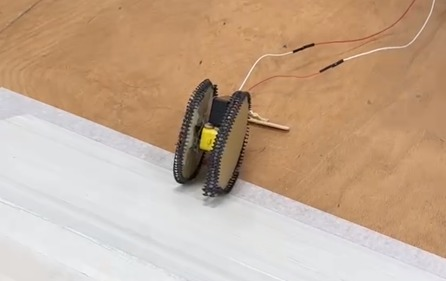
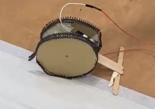
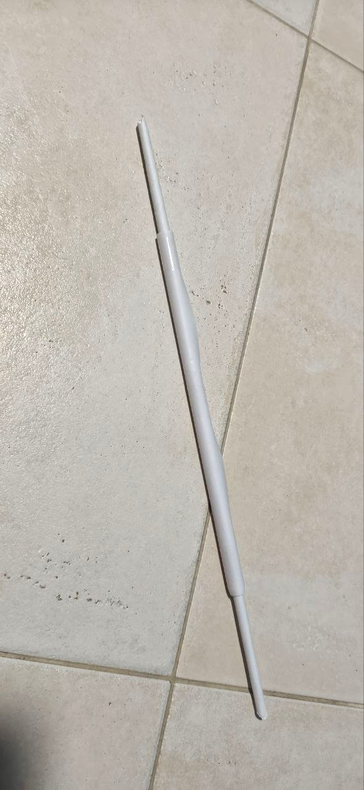
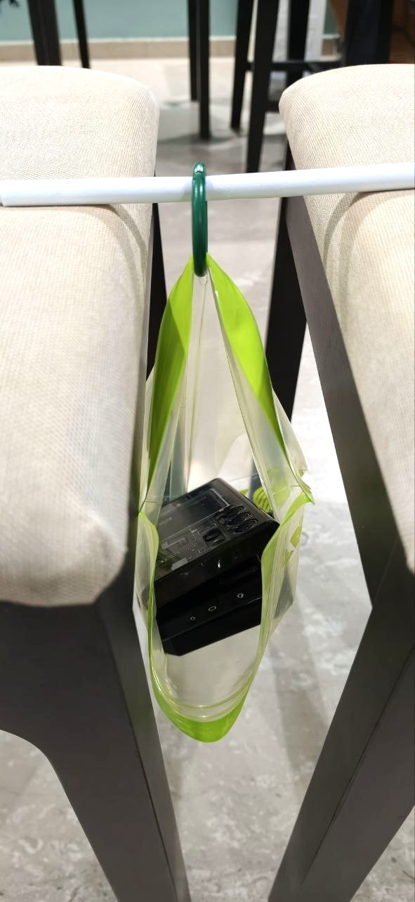
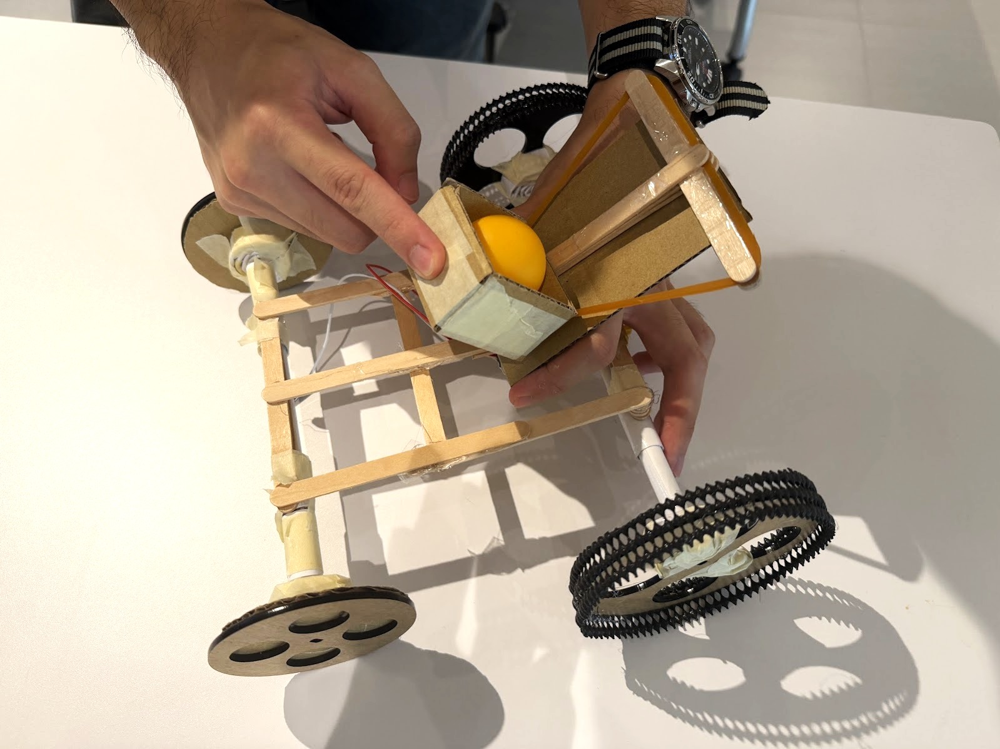
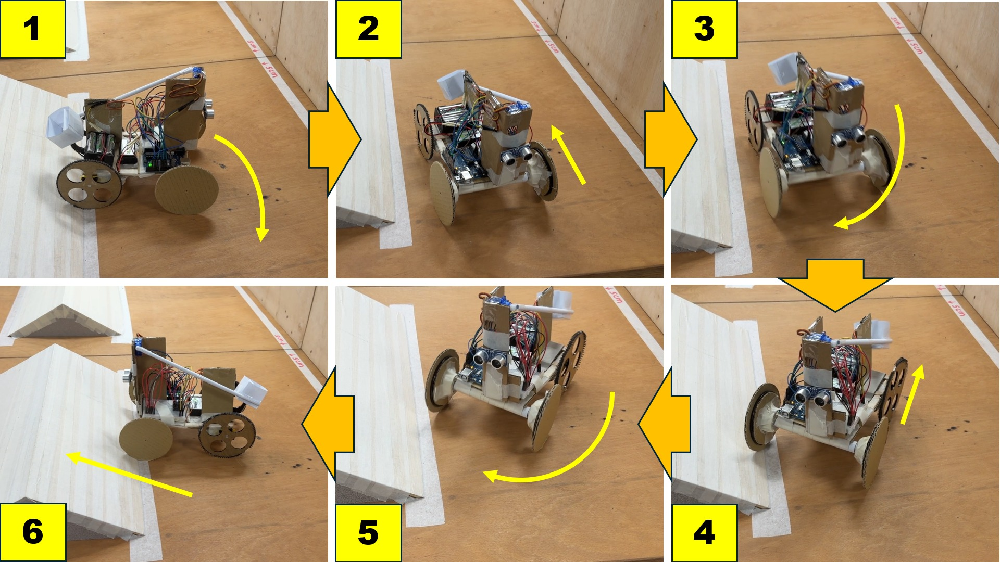

# EG1311 — Autonomous Obstacle-Course Robot

**National University of Singapore | EG1311 Design and Make | AY2026/27 Semester 1**

## Project Overview

As part of NUS EG1311 Design and Make (AY2026/27 Semester 1), our six-member team designed, built, and tested an autonomous robot capable of navigating an obstacle course and delivering a ping-pong ball over a wall.

### Design Requirements

The robot was required to:

- Autonomously traverse a 30 mm square bump and a triangular ramp.
- Approach a wall and launch a ping-pong ball over it.
- Return behind the initial bump.
- Complete the entire sequence within 30 seconds.
- Minimise weight to compete for an additional bonus point.

### Final Outcome

**Final Result: 9/10 points**

Our final robot successfully completed the obstacle course, including the ball-launching and return manoeuvres.

The design featured:

- A lightweight chassis constructed primarily from cardboard, paper, and ice-cream sticks.
- Two independently driven rear wheels.
- An Arduino-controlled drivetrain and servo-actuated ball launcher.
- Ultrasonic distance sensing for wall detection.
- A multi-stage differential-drive turning manoeuvre inspired by a conventional three-point turn.

The project involved extensive physical prototyping, iterative testing, mechanical troubleshooting, and redesign under tight time constraints.

Although our final design achieved the functional objectives, we did not secure the additional point awarded for minimum weight.

## Final Robot

The final robot was developed through repeated physical prototyping and testing. Rather than following a CAD-first design process, our team primarily relied on hands-on experimentation, making adjustments based on observed performance.

### Final Assembly

### Hardware Architecture

| Component | Implementation |
|---|---|
| Microcontroller | Arduino |
| Motor Driver | L293D |
| Drivetrain | Dual-motor rear-wheel drive |
| Distance Sensing | HC-SR04 ultrasonic sensor |
| Ball Launcher | Directly servo-actuated paper arm and cup |
| Chassis | Cardboard with reinforced structural supports |
| Wheels | Direct-drive rear wheels with passive front wheels |
| Power Supply | 6 × AA battery pack for motors; separate 9V battery for Arduino |

### Key Design Principles

**1. Mechanical Simplicity**

Earlier launcher and drivetrain designs introduced unnecessary mechanical complexity and potential failure points.

The final configuration directly coupled the driving wheels to their motors and the lightweight launching arm to its servo, reducing the number of moving components.

**2. Stability and Weight Distribution**

We adopted a wider, reinforced chassis and positioned the centre of gravity closer to the rear driving wheels.

This improved traction and reduced the tendency to topple while traversing the ramp.

**3. Modularity and Repairability**

The final assembly incorporated removable components secured through friction-fit connections and tape.

This allowed us to reposition or replace components quickly during testing, which proved especially valuable under tight time constraints.

The final configuration prioritised reliability and repeatability over the original goal of achieving the lowest possible weight.

## Engineering Development

Our robot was developed through an iterative, hands-on engineering process. Rather than relying heavily on CAD during development, we constructed physical prototypes, tested their performance, identified weaknesses, and modified the design accordingly.

### 1. Initial Direct-Drive Feasibility Test

Our earliest experiment focused on determining whether a simple direct-drive configuration could traverse the obstacle course.

We attached wheels directly to a motor supported by a basic ice-cream-stick structure.

The initial configuration demonstrated that direct drive was feasible, but also revealed several limitations:

- The structure was prone to toppling sideways.
- The narrow base offered insufficient stability.
- The assembly lacked the structural rigidity required for additional components.

These observations motivated the development of a wider, reinforced chassis.

### 2. Lightweight Paper Axle Development

Weight minimisation was an early design priority because the assessment awarded an additional point to the lightest robot.

We experimented with tightly rolled paper as a lightweight axle material, securing the paper with tape to form cylindrical structural members.

We also conducted a simple load-bearing demonstration to evaluate the rigidity of the paper structure.

Although the paper axle demonstrated promising static strength, integrating it into a fully loaded drivetrain introduced additional challenges.

The combination of mechanical loading, flexible joints, and drivetrain alignment made the original arrangement insufficiently reliable.

This highlighted an important distinction between the strength of an individual component and its performance within a complete mechanical system.

### 3. Chassis and Launcher Development

Following the initial experiments, we developed a wider chassis using cardboard, ice-cream sticks, and lightweight structural supports.

We also experimented with wheel materials, axle arrangements, and traction-enhancing surfaces, including tape and protective foam packaging commonly used around fruit.

Our early chassis successfully traversed the obstacle course before the complete electronics and launching mechanism were installed.

With the basic chassis functioning, we investigated several launching mechanisms.

**Rubber-Band Crossbow**

Our crossbow concept stored elastic potential energy in a rubber band, with the servo intended to release a mechanical latch.

The objective was to separate energy storage from the triggering mechanism, potentially reducing the loading imposed on the servo.

Although the mechanism worked independently, mounting it reliably onto the robot introduced additional mechanical complexity.

**Traditional Catapult**

We subsequently experimented with a conventional catapult arrangement and several mounting configurations.

A triangulated support structure was introduced to reinforce the launcher mounting and reduce deformation of the chassis during operation.

However, the launcher and its mounting arrangement introduced additional mass, mechanical loading, and reliability concerns.

**Final Direct-Drive Servo Launcher**

Our final solution returned to a simpler mechanism: a lightweight paper arm and ball holder driven directly by the servo.

This eliminated the need for a separate energy-storage mechanism and reduced the number of moving components.

The final launcher prioritised simplicity, low moving mass, and repeatable operation.

### 4. Integration and Structural Redesign

One of the most significant challenges emerged when we combined the individually functioning subsystems.

The basic chassis could traverse the course, and the launcher could operate independently. However, the additional mass of the electronics, batteries, and launching mechanism substantially changed the robot's behaviour.

Problems included:

- Excessive forward weight distribution causing the robot to topple when descending the ramp.
- Reduced traction when components were repositioned toward the rear.
- Structural deformation and failure of glued joints.
- Wheel and axle misalignment under load.
- Insufficient torque from the original single-motor drivetrain.

On the Friday before final testing, we substantially rebuilt the robot.

The redesign introduced a dual-motor drivetrain, improved structural reinforcement, revised component placement, and more secure mounting arrangements.

We ultimately abandoned aggressive weight minimisation in favour of mechanical reliability.

This redesign became the foundation of our successful final configuration.

---

## Challenges and Solutions

### 1. Weight Distribution and Ramp Stability

**Problem**

The robot's centre of gravity strongly influenced its ability to traverse the obstacle course.

A front-heavy configuration caused the robot to topple while descending the ramp. Shifting the mass rearward introduced traction and uphill-climbing difficulties.

**Solution**

We iteratively adjusted component placement, widened and reinforced the chassis, and positioned the centre of gravity closer to the driven rear wheels.

**Engineering Lesson**

Weight distribution must be evaluated under actual operating conditions. A configuration that appears stable on a flat surface may behave differently on an incline.

### 2. Ultrasonic Sensing and Stopping Distance

**Problem**

The robot needed to stop within 5 cm of the wall without colliding with it.

Initially, we experimented with controlling forward movement using fixed durations. However, motor speed varied with battery condition, causing inconsistent stopping positions.

**Solution**

We returned to ultrasonic distance sensing and calibrated the stopping threshold through repeated testing.

The final control strategy used a 10 cm detection threshold to account for the robot's remaining forward motion after the motors were stopped.

**Engineering Lesson**

Control decisions must account for real-world mechanical behaviour, including momentum, friction, and variations in actuator performance.

### 3. Differential Steering and the Three-Point Turn

One of our most distinctive solutions was the return manoeuvre.

**Problem**

After launching the ping-pong ball, the robot needed to return across the obstacle course.

Because the robot's weight distribution favoured forward travel, reversing over the ramp was unreliable and could cause the robot to topple.

**Initial Approach**

We used the two independently driven rear motors to implement differential steering.

By commanding the motors to rotate in opposite directions, the robot could change its heading without a conventional steering mechanism.

However, attempting one continuous 180-degree turn produced inconsistent movement and caused the robot to drift off the track.

**Final Solution**

Inspired by the three-point turn used in conventional driving, we divided the manoeuvre into multiple smaller rotations separated by short reversing movements.

The sequence used the ramp geometry to help reposition and align the robot before its return journey.

This allowed the robot to:

- Reorient itself to face the return direction.
- Avoid traversing the ramp backwards with an unfavourable weight distribution.
- Use the ramp as a physical alignment reference.
- Achieve a more consistent return manoeuvre.

The resulting sequence became one of the defining features of our final design.

**Engineering Lesson**

A theoretically simple motion may become unreliable when implemented physically. Dividing a complex manoeuvre into smaller, repeatable movements can improve consistency under real-world constraints.

---

## Final Demonstration

Our completed robot successfully performed the required obstacle-course sequence during the graded assessment.

The robot:

1. Traversed the initial bump and ramp.
2. Approached the wall using ultrasonic distance detection.
3. Launched the ping-pong ball over the wall.
4. Executed the multi-stage turning manoeuvre.
5. Returned across the obstacles to the starting area.

**Final Assessment Result: 9/10 points**

The robot achieved the functional objectives. The remaining point was associated with the weight-based bonus criterion.

Following the successful run, we attempted to construct a substantially lighter alternative within approximately 30 minutes. However, this configuration proved unstable on the ramp, and we retained our original successful design.

### Project Documentary

To document the engineering journey, we produced a humorous technical documentary covering the design process, prototype failures, emergency rebuild, final innovations, and successful assessment.

The video combines actual development footage, engineering explanations, CAD visualisations, narration, and edited demonstrations.

**Project Video:** [Add video link here]

The documentary was submitted and screened during our EG1311 class on 3 November 2026.

---

## Contributions and Credits

### My Contributions

This was a collaborative six-member engineering project, with most of the physical development carried out collectively.

My contributions included:

- Participating extensively in mechanical design discussions and concept evaluation.
- Hands-on fabrication, assembly, and modification of physical prototypes.
- Experimentation with lightweight materials, structural configurations, and wheel traction.
- Troubleshooting chassis stability, weight distribution, and subsystem integration.
- Participating in the development and testing of the multi-stage turning strategy.
- Supporting iterative testing, redesign, and final hardware integration.
- Leading the planning, editing, and production of the final project documentary.

### Team Contributions

The final robot was developed collaboratively by the project team.

The Arduino firmware, formal engineering report, and post-development CAD documentation were primarily produced by other team members.

**Arduino Firmware:** [Link to team's GitHub repository]

### Acknowledgements

National University of Singapore  
EG1311 Design and Make  
AY2026/27 Semester 1

Thanks to our teammates, teaching assistants, and instructors for their contributions and guidance throughout the project.
