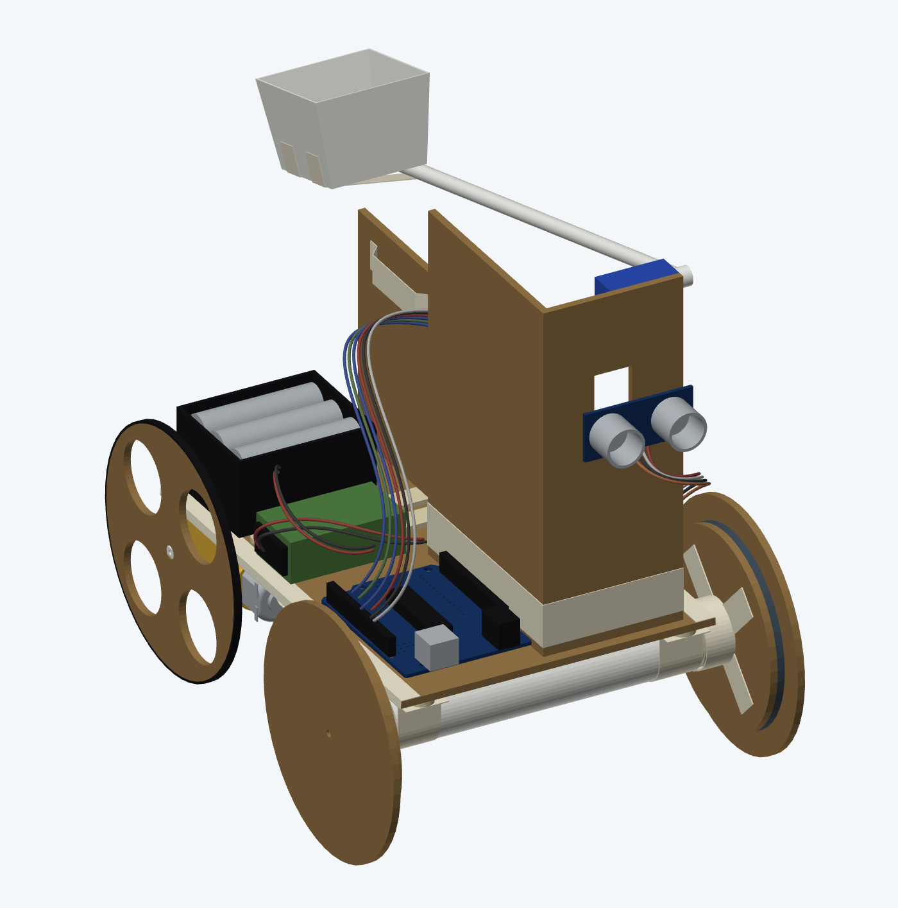

# EG1311 — Autonomous Obstacle-Course Robot

**National University of Singapore | EG1311 Design and Make | AY2026/27 Semester 1**

A collaborative engineering project involving the design, fabrication, testing, and iterative development of an autonomous robot capable of navigating an obstacle course, launching a ping-pong ball over a wall, and returning to its starting area.

**Final Assessment Result: 9/10**

---

## Project Overview

As part of NUS EG1311 Design and Make, our six-member team designed and built an autonomous robot under strict time, material, and performance constraints.

### Design Requirements

The robot was required to:

- Autonomously traverse a 30 mm square bump and a triangular ramp.
- Approach a wall and launch a ping-pong ball over it.
- Return behind the initial bump.
- Complete the entire sequence within 30 seconds.
- Minimise weight to compete for an additional bonus point.

Our approach focused on lightweight construction, mechanical simplicity, and repeated physical experimentation.

Rather than relying extensively on CAD during development, we primarily constructed physical prototypes, evaluated their performance on the actual obstacle course, and modified the design based on observed failures.

The project ultimately demonstrated the importance of system integration, weight distribution, mechanical reliability, and iterative testing.

---

## Project Documentary

**[▶ Watch the Full Project Documentary](https://drive.google.com/file/d/1yghTcQ48Xz5H5TcIuv9oKxgPzhpPpsCA/view)**

A humorous technical documentary covering our engineering journey, from lightweight paper prototypes and mechanical failures to an emergency rebuild and successful final assessment.

I led the planning, editing, and production of the documentary using DaVinci Resolve, combining actual development footage, technical explanations, narration, animations, music, and visual storytelling.

The documentary was submitted and screened during our EG1311 class on 3 November 2026.

---

## Final Robot

The final robot was developed through multiple physical iterations, with the final configuration prioritising reliability and repeatability over aggressive weight minimisation.

### Final Assembly

### Hardware Architecture

| Component | Implementation |
|---|---|
| Microcontroller | Arduino Uno |
| Motor Driver | L293D |
| Drivetrain | Dual-motor rear-wheel drive |
| Distance Sensing | HC-SR04 ultrasonic sensor |
| Ball Launcher | Directly servo-actuated paper arm and cup |
| Chassis | Cardboard, paper, and lightweight structural supports |
| Wheels | Direct-drive rear wheels with passive front wheels |
| Power Supply | 6 × AA battery pack for motors; separate 9V battery for Arduino |

### Key Design Principles

**1. Mechanical Simplicity**

Earlier launcher and drivetrain concepts introduced additional moving parts, mechanical loading, and reliability concerns.

The final design directly coupled the driving wheels to their motors and the lightweight launching arm to its servo, reducing unnecessary mechanical complexity.

**2. Stability and Weight Distribution**

We adopted a wider, reinforced chassis and repositioned the centre of gravity closer to the rear driving wheels.

This improved traction and reduced the tendency to topple while traversing the ramp.

**3. Modularity and Repairability**

The final assembly incorporated removable components secured using friction-fit connections and tape.

This allowed components to be repositioned or replaced quickly during testing and troubleshooting.

---

## Engineering Development

Our engineering process relied heavily on physical prototyping, testing, troubleshooting, and iterative redesign.

### 1. Initial Direct-Drive Feasibility Test

Our earliest experiment investigated whether a simple direct-drive configuration could traverse the obstacle course.

We attached wheels directly to a motor supported by a basic ice-cream-stick structure.

The configuration demonstrated that direct drive was feasible, but revealed several limitations:

- The structure was prone to toppling sideways.
- The narrow base offered insufficient stability.
- The assembly lacked the rigidity required to support additional components.

These observations motivated the development of a wider, reinforced chassis.

### 2. Lightweight Paper Axle Development

Weight minimisation was an early priority because the assessment awarded an additional point to the lightest robot.

We experimented with tightly rolled paper as a lightweight axle material, securing the paper with tape to form cylindrical structural members.

We conducted a simple load-bearing demonstration to evaluate the rigidity of the paper structure.

Although the paper axle demonstrated promising static strength, integrating it into the fully loaded drivetrain introduced additional challenges.

Mechanical loading, flexible joints, and drivetrain alignment made the original arrangement insufficiently reliable.

This highlighted the distinction between the strength of an individual component and its performance within a complete mechanical system.

### 3. Chassis and Launcher Development

Following the initial experiments, we developed a wider chassis using cardboard, ice-cream sticks, and lightweight structural supports.

We experimented with wheel materials, axle arrangements, and traction-enhancing surfaces, including tape and protective foam packaging commonly used around fruit.

Our early chassis successfully traversed the obstacle course before the complete electronics and launching mechanism were installed.

With the basic chassis functioning, we investigated several launching mechanisms.

#### Rubber-Band Crossbow

Our crossbow concept stored elastic potential energy in a rubber band, with the servo intended to release a mechanical latch.

The objective was to separate energy storage from the triggering mechanism, potentially reducing the mechanical loading imposed on the servo.

Although the mechanism worked independently, mounting it reliably onto the robot introduced additional mechanical complexity.

#### Traditional Catapult

We subsequently experimented with a conventional catapult arrangement and several mounting configurations.

A triangulated support structure was introduced to reinforce the launcher mounting and reduce deformation of the chassis during operation.

However, the launcher and its mounting arrangement introduced additional mass, mechanical loading, and reliability concerns.

#### Final Direct-Drive Servo Launcher

Our final solution returned to a simpler mechanism: a lightweight paper arm and ball holder driven directly by the servo.

This eliminated the need for a separate energy-storage mechanism and reduced the number of moving components.

The final launcher prioritised simplicity, low moving mass, and repeatable operation.

### 4. Integration and Structural Redesign

One of the most significant challenges emerged when we combined the individually functioning subsystems.

The basic chassis could traverse the course, and the launcher could operate independently. However, adding the electronics, batteries, and launching mechanism substantially changed the robot's behaviour.

Problems included:

- Excessive forward weight distribution causing the robot to topple while descending the ramp.
- Reduced traction when components were repositioned toward the rear.
- Structural deformation and failure of glued joints.
- Wheel and axle misalignment under load.
- Insufficient torque from the original single-motor drivetrain.

On the Friday before final testing, we substantially rebuilt the robot.

The redesign introduced a dual-motor drivetrain, improved structural reinforcement, revised component placement, and more secure mounting arrangements.

We ultimately abandoned aggressive weight minimisation in favour of mechanical reliability.

This redesign became the foundation of our successful final configuration.

---

## Challenges and Solutions

### 1. Weight Distribution and Ramp Stability

**Problem**

The robot's centre of gravity strongly influenced its ability to traverse the obstacle course.

A front-heavy configuration caused the robot to topple while descending the ramp. Shifting mass rearward introduced traction and uphill-climbing difficulties.

**Solution**

We iteratively adjusted component placement, widened and reinforced the chassis, and positioned the centre of gravity closer to the driven rear wheels.

**Engineering Lesson**

Weight distribution must be evaluated under actual operating conditions. A configuration that appears stable on a flat surface may behave differently on an incline.

### 2. Ultrasonic Sensing and Stopping Distance

**Problem**

The robot needed to stop within 5 cm of the wall without colliding with it.

Initially, we experimented with controlling forward movement using fixed durations. However, motor speed varied with battery condition, causing inconsistent stopping positions.

**Solution**

We returned to ultrasonic distance sensing and calibrated the stopping threshold through repeated testing.

The final control strategy used a 10 cm detection threshold to account for the robot's remaining forward motion after the motors were stopped.

**Engineering Lesson**

Control decisions must account for real-world mechanical behaviour, including momentum, friction, and variations in actuator performance.

### 3. Differential Steering and the Three-Point Turn

One of our most distinctive solutions was the return manoeuvre.

**Problem**

After launching the ping-pong ball, the robot needed to return across the obstacle course.

Because the robot's weight distribution favoured forward travel, reversing over the ramp was unreliable and could cause the robot to topple.

**Initial Approach**

We used the two independently driven rear motors to implement differential steering.

By commanding the motors to rotate in opposite directions, the robot could change its heading without a conventional steering mechanism.

However, attempting one continuous 180-degree turn produced inconsistent movement and caused the robot to drift off the track.

**Final Solution**

Inspired by the three-point turn used in conventional driving, we divided the manoeuvre into multiple smaller rotations separated by short reversing movements.

The sequence used the ramp geometry to help reposition and align the robot before its return journey.

This allowed the robot to:

- Reorient itself to face the return direction.
- Avoid traversing the ramp backwards with an unfavourable weight distribution.
- Use the ramp as a physical alignment reference.
- Achieve a more consistent return manoeuvre.

**Engineering Lesson**

A theoretically simple motion may become unreliable when implemented physically. Dividing a complex manoeuvre into smaller, repeatable movements can improve consistency under real-world constraints.

---

## Final Demonstration

Our completed robot successfully performed the required obstacle-course sequence during the graded assessment.

The robot:

1. Traversed the initial bump and ramp.
2. Approached the wall using ultrasonic distance detection.
3. Launched the ping-pong ball over the wall.
4. Executed the multi-stage turning manoeuvre.
5. Returned across the obstacles to the starting area.

### Final Assessment Result: 9/10

The robot successfully completed the functional objectives, with the remaining point associated with the weight-based bonus criterion.

Following our successful run, we attempted to construct a substantially lighter alternative within approximately 30 minutes.

However, the alternative configuration proved unstable on the ramp, and we retained our original successful design.

**[Watch the Final Run and Project Documentary](https://drive.google.com/file/d/1yghTcQ48Xz5H5TcIuv9oKxgPzhpPpsCA/view)**

---

## Arduino Firmware

The final robot used an Arduino-based control system to coordinate its drivetrain, ultrasonic sensor, and servo-actuated launcher.

### Control Architecture

The firmware implemented:

- **Motor Control:** Two independently driven DC motors controlled through an L293D motor driver.
- **Wall Detection:** An HC-SR04 ultrasonic sensor used to determine when the robot should stop approaching the wall.
- **Launcher Control:** Servo actuation to release the ping-pong ball over the wall.
- **Differential Steering:** Opposing motor directions to rotate the robot.
- **Multi-Stage Turning:** A sequence of timed rotations and reverse movements to reposition the robot for its return journey.
- **Movement Stabilisation:** Short delays between actions to allow the robot to settle before executing subsequent movements.

### Control Sequence

1. Initialise the motors, ultrasonic sensor, and servo.
2. Drive forward while monitoring the distance to the wall.
3. Stop when the calibrated distance threshold is reached.
4. Activate the servo-powered launcher.
5. Reverse slightly to provide clearance from the wall.
6. Execute the multi-stage turning sequence.
7. Drive forward across the obstacles to return to the starting area.

The final approach used ultrasonic sensing rather than relying solely on fixed motor-running durations, as motor speed varied with battery condition.

The return manoeuvre used timed movements calibrated through repeated physical testing.

### Source Code

The Arduino source code is available in the [`firmware/`](firmware/) directory.

**Original team repository:** [EG1311-code](https://github.com/itsme-zeix/EG1311-code)

The firmware was primarily developed by other team members. This copy was obtained from the original team repository and is included to document the complete robot system.

Hardware integration, calibration, troubleshooting, and testing were conducted collaboratively.

---

## Contributions and Credits

### My Contributions

This was a collaborative six-member engineering project, with most of the physical development carried out collectively.

I contributed substantially throughout the hands-on engineering process, including:

- Mechanical design discussions and concept evaluation.
- Fabrication, assembly, and modification of physical prototypes.
- Experimentation with lightweight materials, structural configurations, and wheel traction.
- Troubleshooting chassis stability, weight distribution, and subsystem integration.
- Development and testing of the multi-stage turning strategy.
- Iterative testing, structural redesign, and final hardware integration.

In addition to the engineering work, I took primary responsibility for the project's video production, including:

- Developing the documentary's narrative structure and storyboard.
- Planning and editing the visual presentation of engineering decisions and failures.
- Producing technical overlays, animations, and visual explanations.
- Integrating narration, music, sound effects, subtitles, and project footage.
- Editing and delivering the final project documentary using DaVinci Resolve.

### Team Contributions

The final robot was designed, assembled, tested, and refined collaboratively by our six-member project team.

The Arduino firmware, formal engineering report, and post-development CAD documentation were primarily produced by other team members.

The CAD models were predominantly created to document the completed design rather than being used extensively during physical development.

### Acknowledgements

**National University of Singapore**  
EG1311 Design and Make  
AY2026/27 Semester 1

Special thanks to my teammates, teaching assistants, and instructors for their contributions and guidance throughout the project.
